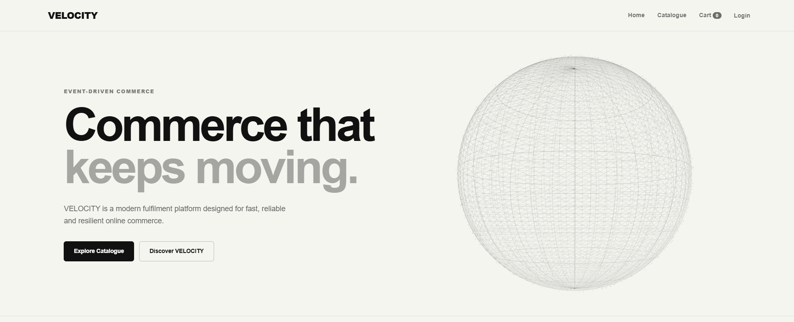
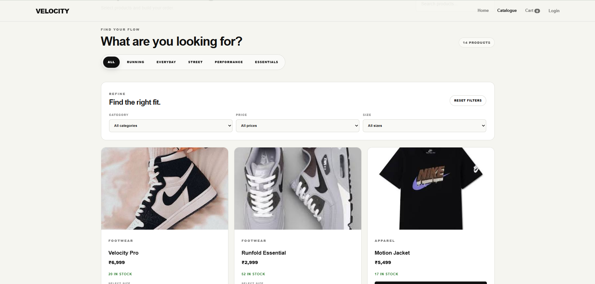
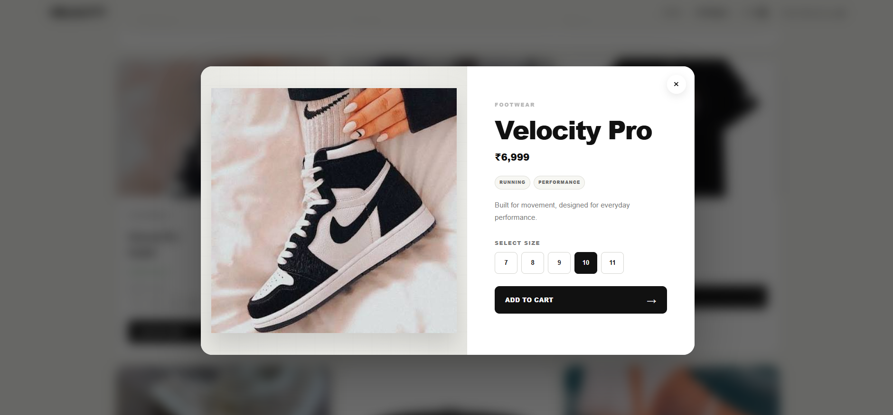
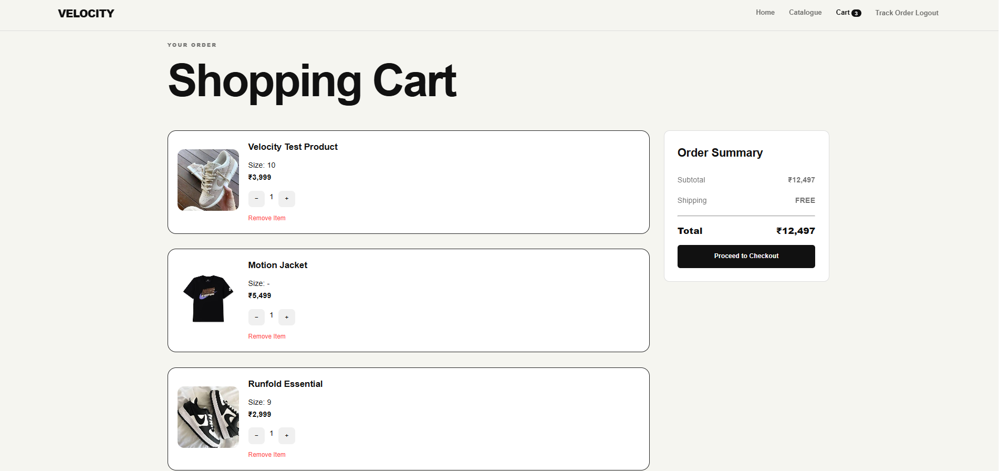
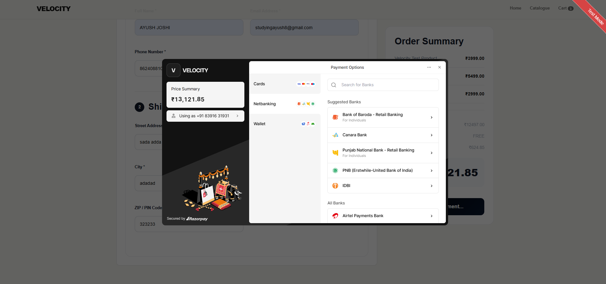
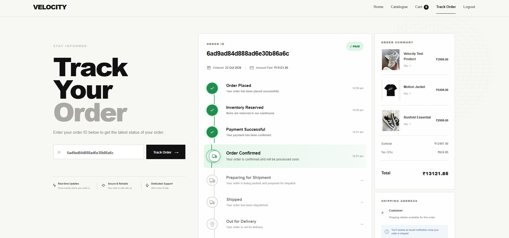
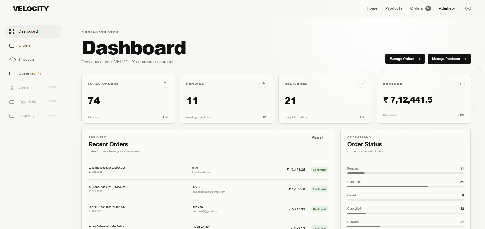

# VELOCITY — E-Commerce Platform

> A production-deployed e-commerce website built with a plain HTML/CSS/JavaScript frontend, Node.js/Express backend, MongoDB, RabbitMQ-based event-driven workflows, and Razorpay test payments.

**Live Demo:** https://velocity-ecom.vercel.app  
**Backend Health:** https://velocity-y30h.onrender.com/api/health  
**Source Code:** Private repository (not included in this public showcase repository)

---

## Screenshots

_Add your own screenshots below. Upload images into this repository (for example, in a `screenshots/` folder), then replace the placeholder paths with their filenames._

### Homepage
<!-- Add screenshot: screenshots/homepage.png -->


### Product Catalogue
<!-- Add screenshot: screenshots/catalogue.png -->


### Product Details
<!-- Add screenshot: screenshots/product-details.png -->


### Cart
<!-- Add screenshot: screenshots/cart.png -->


### Checkout / Test Payment
<!-- Add screenshot: screenshots/checkout.png -->


### Order Tracking
<!-- Add screenshot: screenshots/order-tracking.png -->


### Admin Dashboard
<!-- Add screenshot: screenshots/admin-dashboard.png -->


---

## Overview

VELOCITY is an e-commerce web application designed to demonstrate a full-stack shopping flow and backend event-driven processing. The frontend is deployed on Vercel, while the API is deployed on Render. MongoDB provides persistent application data, and CloudAMQP hosts RabbitMQ for asynchronous messaging.

The production payment integration is currently configured for **Razorpay test mode**. This showcase describes the project and its architecture; it does not grant access to the private source code or production administration.

## Features

- User authentication using JWT
- Product catalogue
- Shopping cart
- Order creation and order tracking
- Razorpay test-payment integration
- RabbitMQ messaging and SAGA-style event-driven workflows
- Retry/dead-letter queue (DLQ) handling for message failures
- MongoDB persistence
- Backend security measures including Helmet, rate limiting, and protected routes
- Dockerized backend
- GitHub Actions CI workflow for dependency installation and Docker image build
- Deployed frontend and backend

## Technology Stack

| Layer | Technologies |
|---|---|
| Frontend | HTML, CSS, JavaScript |
| Backend | Node.js, Express |
| Database | MongoDB |
| Messaging | RabbitMQ, CloudAMQP |
| Payments | Razorpay (test mode) |
| Authentication | JWT, bcrypt |
| Deployment | Vercel, Render |
| Containers | Docker |
| CI | GitHub Actions |

## Architecture

```text
Customer Browser
      |
      v
Vercel — Static Frontend
      |
      v
Render — Node.js / Express API
      |
      +------> MongoDB — Application Data
      |
      +------> CloudAMQP / RabbitMQ
                    |
                    v
             Asynchronous Consumers
             (SAGA / retry / DLQ flows)
```

## Deployment

- **Frontend:** https://velocity-ecom.vercel.app
- **Backend health endpoint:** https://velocity-y30h.onrender.com/api/health
- **Production RabbitMQ:** CloudAMQP
- **Payments:** Razorpay test mode

The backend health endpoint is provided as a simple availability check. It is not a public API documentation page.

## Quality and Testing

Work completed during development included:

- API checks using Postman
- Local health endpoint verification
- A local load-test baseline against the health endpoint
- RabbitMQ failure/recovery checks
- Docker image build and container run
- GitHub Actions CI workflow
- Production frontend/backend connection checks

The local load-test result was a baseline for the health endpoint only; it should not be interpreted as a production capacity benchmark.

## Screenshots: How to Add Them

1. Create a folder named `screenshots` beside this `README.md`.
2. Take screenshots of the live website. Avoid including real personal data, email addresses, tokens, payment details, or admin credentials.
3. Save each image using the filenames shown above.
4. Upload the images to `screenshots/` and commit them to this public showcase repository.
5. If you do not have a screenshot ready for a section, remove that image line until you add one.

## Commercial Availability

VELOCITY may be available for commercial licensing or purchase. The source code is maintained separately in a private repository.

For inquiries, contact: **[Add your preferred business contact here]**

**Important:** A purchase or license should explicitly define what is included, such as source-code access, deployment transfer, domain transfer, setup/support, and third-party service costs. Do not promise ownership or transfer of third-party services or accounts that cannot legally be transferred.

## Security and Privacy Notes

- This public repository is intended to contain project documentation and approved screenshots only.
- Do **not** publish `.env` files, API secrets, JWT secrets, database connection strings, RabbitMQ/CloudAMQP URLs, credentials, private source files, or customer data.
- Razorpay is configured for test payments; real payments should not be represented as enabled.
- Before sharing the live demo publicly, review whether the public health endpoint and any other exposed endpoints reveal information you do not want to disclose.
- The public README does not include installation instructions for the private source code.

## Roadmap Ideas for a Future Version

Potential future improvements (not represented as completed features):

- Optimize catalogue and cart API response times
- Improve database indexing and query performance
- Add more advanced catalogue search, filtering, and sorting
- Expand admin workflows
- Improve monitoring, structured logging, and automated test coverage
- Continue improving loading states, accessibility, and mobile UX

---

*VELOCITY project showcase. Update the screenshots, contact details, and any feature descriptions before publishing.*
